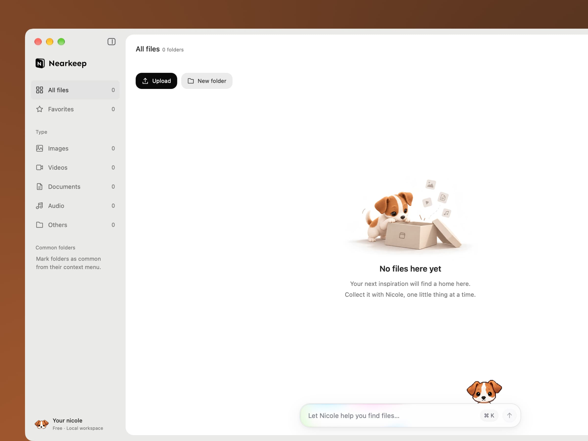

<h1 align="center">Nearkeep</h1>

<strong>Keep what matters close.</strong>

A local-first workspace for files worth keeping, with Nicole by your side. Collect files, organize them in folders you control, and find them when you need them.

  <a href="https://github.com/jayueseven/Nearkeep/releases/latest"><strong>Download for Mac</strong></a> ·
  <a href="https://github.com/jayueseven/Nearkeep/releases/tag/v1.0.1-windows"><strong>Download for Windows</strong></a>

  <a href="#get-started">Get started</a> ·
  <a href="https://github.com/jayueseven/Nearkeep/releases">Release notes</a> ·
  <a href="https://github.com/jayueseven/Nearkeep/issues">Feedback</a>

<strong>English</strong> · <a href="./README.zh-CN.md">简体中文</a>

Free to download · macOS available · Windows x64 available

## A home for the files you want to keep

Screenshots, reference images, PDFs and project files deserve a place you can find again. Nearkeep brings them into one local workspace: collect new files, connect existing folders, and search your collection without remembering every filename.

**Nicole** is your desktop companion and a quick way into your files. Drop files onto her to collect them through **Pocket**, then browse and organize them in **Library**. Her feedback follows real tasks as Nearkeep imports, organizes and searches.

## Collect. Organize. Find. Use.

Available in the current macOS release:

| What you need | How Nearkeep helps |
| --- | --- |
| **Collect** | Import files, folders or mixed batches through Upload, the Library or desktop Nicole. Choose Copy or Move; nested and empty folders are preserved. |
| **Organize** | Work with real folders, favorites and common folders. Link an existing local folder to manage it in place. |
| **Find** | Search by name or keywords, or describe content in supported documents. Local semantic search adds relevant matches. |
| **Use** | Preview files, locate them in the Library or reveal them in Finder. Open quick search from other apps while Nearkeep is running. |

English and Chinese interfaces. Light and dark themes. Adjustable desktop companion settings.

## From saving something to using it again

- **Keep a reference without losing your flow.** Drop a screenshot or design reference onto Nicole, choose Copy or Move, and return to your work. Find it in Library when you need it.
- **Find a document by what you remember.** If you remember a topic but not the filename, describe it in search. Local semantic retrieval can surface matching passages from supported, indexed text documents; open the original to check the context.
- **Bring an existing collection into view.** Link a project or reference folder in Settings to browse it where it already lives, without copying the whole collection.

## Get started

| Platform | Availability | Download |
| --- | --- | --- |
| macOS · Apple Silicon | Available now | [Download for Mac](https://github.com/jayueseven/Nearkeep/releases/latest) |
| Windows | Coming soon · Not yet publicly released | **Download for Windows — coming soon** |

Current release: **Apple Silicon Mac**, deployment target **macOS 14**. Tested on macOS 27.0.1; other versions are not fully validated. **Ad-hoc signed and not Apple-notarized**; macOS may block the first launch.

1. Download the ZIP and checksum file from the release page. Follow the [installation guide](./docs/getting-started.md) to verify and install.
2. Open Nearkeep and choose a dedicated storage folder on first use.
3. Import your first files, or link an existing folder in Settings.

**Choose how your files are stored:** Copy keeps the originals; Move removes them from the source after a successful save. Linked folders stay in place: renaming, moving or deleting their contents affects the original files. Unlinking keeps them.

## Local by design

Your files live in a folder you choose and remain accessible outside Nearkeep. File management, indexing and semantic search run locally on your computer. Document text is not sent to cloud AI. OS services and external links may still use the network.

Content search covers text-based PDFs and supported text files. Scanned PDFs and Office document bodies are not currently covered; long files may be only partly indexed. Semantic results help you find passages, so check the source document. See [search and privacy details](./docs/search-and-privacy.md).

The current public release does not include chat, generated summaries, cloud sync or an Intel Mac package.

Planned: Ask Nicole and timeline navigation

Future directions include asking questions about your files with answers linked to their sources, finding saved material through time-based navigation, and searching more content formats. These capabilities are planned and are not part of the current public release; release dates have not been announced.

## Updates & feedback

Latest: **[Nearkeep 1.0.1](./docs/releases/v1.0.1.md)** — editable shortcuts and refined Settings.

See [Releases](https://github.com/jayueseven/Nearkeep/releases) for changes and manual updates. Quit Nearkeep before updating, keep your storage folder, and maintain an independent backup.

Have a bug or an idea? [Open an issue](https://github.com/jayueseven/Nearkeep/issues) or email [jayyueseven@gmail.com](mailto:jayyueseven@gmail.com). For bugs, include your app version, operating system version and steps to reproduce. Please leave out private files and credentials.

---

This repository provides product information and downloads. The Nearkeep application source is private. Third-party notices are included in the app.

