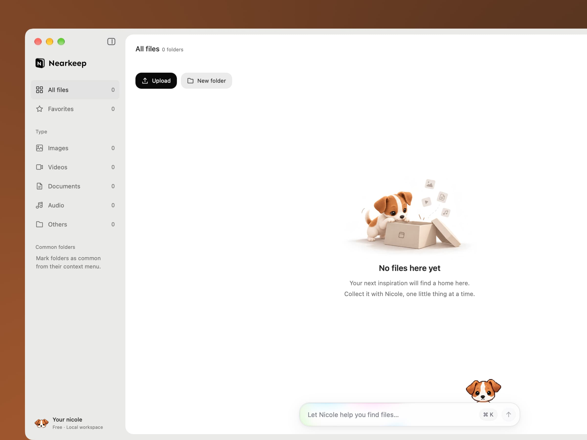

<h1 align="center">Nearkeep</h1>

<strong>让重要的，始终在身边。</strong>

一个本地优先的个人文件工作空间，有 Nicole 陪在身边。 收集值得留下的文件，在自己掌控的文件夹里整理，需要时再找回来。

  <a href="https://github.com/jayueseven/Nearkeep/releases/latest"><strong>下载 Mac 版</strong></a> ·
  <a href="https://github.com/jayueseven/Nearkeep/releases/tag/v1.0.1-windows"><strong>下载 Windows 版</strong></a>

  <a href="#开始使用">开始使用</a> ·
  <a href="https://github.com/jayueseven/Nearkeep/releases">版本记录</a> ·
  <a href="https://github.com/jayueseven/Nearkeep/issues">反馈</a>

<a href="./README.md">English</a> · <strong>简体中文</strong>

免费下载 · macOS 版已发布 · Windows x64 版已发布

## 给值得留下的文件，一个找得到的地方

截图、参考图片、PDF 和项目资料，存下来之后，也应该容易找回来。Nearkeep 把它们带进一个本地工作空间：收取新文件，关联已有文件夹，不必记住每个文件名，也能查找需要的内容。

**Nicole** 是你的桌面伴侣，也是随手收取文件的入口。把文件拖给她，通过 **Pocket** 收纳，再到 **Library 资料库** 浏览和整理。导入、整理和搜索时，她会用动作回应真实进行中的工作。

## 收集、整理、查找、使用

当前 macOS 版本已提供：

| 你想做的事 | Nearkeep 如何帮你 |
| --- | --- |
| **收集** | 点击上传，或拖入资料库、桌面 Nicole。支持文件、文件夹和混合批量；可选择复制或移动，保留嵌套结构与空文件夹。 |
| **整理** | 使用真实文件夹、收藏和常用文件夹管理资料。也可以关联已有的本地文件夹，在原位置管理。 |
| **查找** | 搜索文件名、关键词，或描述受支持文档中的内容，由本地语义检索补充相关结果。 |
| **使用** | 预览文件、在资料库定位，或在访达中显示。Nearkeep 运行时，可通过快速搜索快捷键从其他应用唤出查找。 |

支持中英文界面、浅深色主题，以及桌面伴侣显示设置。

## 从顺手存下，到再次用上

- **收下参考，继续手头的事。** 把截图或设计参考图拖给 Nicole，选择复制或移动，收好后继续工作，需要时再到资料库查看。
- **记得内容，也能试着找回。** 忘了文件名，但记得主题？在搜索中描述它，本地语义检索可以从已建立索引的受支持文本中找出相关片段，再打开原文核对。
- **已有资料，不用搬家。** 在设置中关联项目或参考资料文件夹，保持原位置和目录结构，无须把整套资料再复制一遍。

## 开始使用

| 平台 | 发布状态 | 下载 |
| --- | --- | --- |
| macOS · Apple Silicon | 已发布 | [下载 Mac 版](https://github.com/jayueseven/Nearkeep/releases/latest) |
| Windows · x64 | 已发布 | [下载 Windows 版](https://github.com/jayueseven/Nearkeep/releases/tag/v1.0.1-windows) |

当前版本面向 **Apple Silicon Mac**。最低构建目标为 macOS 14，公开记录的实测环境为 macOS 27.0.1，其他版本尚未全面验收。应用使用**临时签名，尚未通过 Apple 公证**，首次打开可能被 macOS 阻止。

**Windows x64：**从 Windows 版本页下载 EXE 安装包，按 [Windows 安装说明](./docs/releases/v1.0.1-windows.zh-CN.md)完成校验与安装。

1. 从版本页下载 ZIP 和校验文件，按[安装指南](./docs/getting-started.zh-CN.md)完成校验与安装。
2. 首次打开 Nearkeep，选择专用保存文件夹。
3. 导入第一批文件，或在设置中关联已有文件夹。

**由你决定保存方式：**复制会保留原件；移动会在保存成功后移除来源文件。关联文件夹保持原位置，其中的改名、移动或删除会影响原文件；解除关联会保留文件。

## 在本机处理

文件保存在你选择的文件夹中，离开 Nearkeep 也能访问。文件管理、索引和语义检索在你的电脑本地运行，不将文档正文发送给云端 AI。系统服务和外部链接仍可能联网。

正文检索支持有文字层的 PDF 和受支持的文本文件；扫描 PDF、Office 文档正文暂不支持，长文件可能仅覆盖部分内容。语义结果用于帮助定位片段，请结合原文核对。详见[搜索与隐私说明](./docs/search-and-privacy.zh-CN.md)。

当前公开版本尚未提供聊天、生成式摘要、云同步或 Intel Mac 安装包。

规划中：Ask Nicole 与时间轴导航

未来方向包括：围绕个人资料提问并获得带原文出处的回答、按时间找回收集过的内容，以及覆盖更多内容格式。这些能力仍在规划中，不属于当前公开版本，尚未公布发布日期。

## 更新与反馈

最新版本：**[Nearkeep 1.0.1](./docs/releases/v1.0.1.zh-CN.md)** — 修复快捷键编辑，优化设置细节。

在 [Releases](https://github.com/jayueseven/Nearkeep/releases) 查看更新内容并手动下载新版。更新前正常退出 Nearkeep，保留保存文件夹，并为重要资料做好独立备份。

发现问题或有建议？可以[提交 Issue](https://github.com/jayueseven/Nearkeep/issues)，或发邮件至 [jayyueseven@gmail.com](mailto:jayyueseven@gmail.com)。问题反馈请附应用版本、操作系统版本和复现步骤，避免附带私人文件与凭据。

---

本仓库提供产品说明与下载，Nearkeep 应用工程源码暂不公开。第三方许可说明随应用提供。

